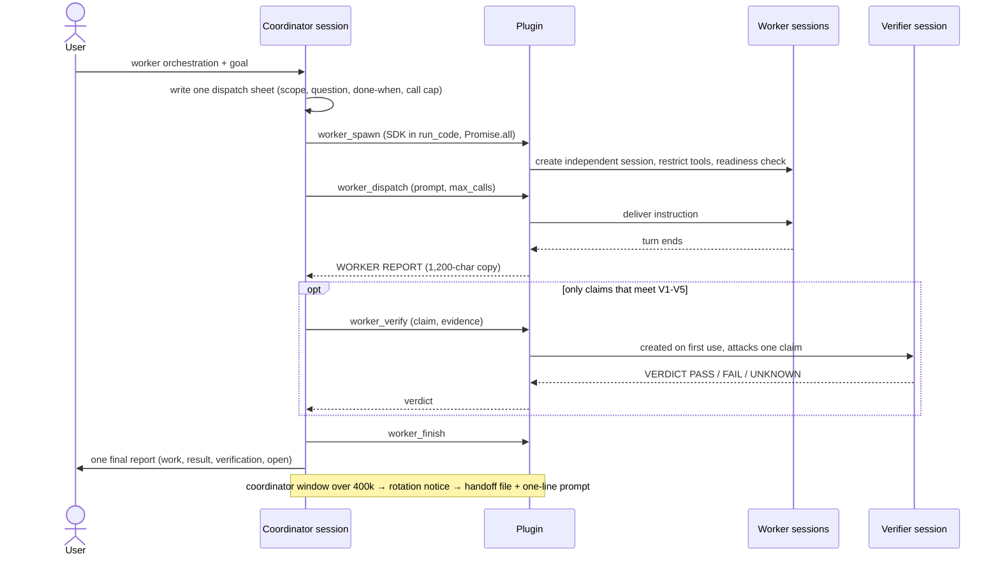

# DSH Worker Orchestration

> A plugin + skill for the DeepSeek Harness (DSH) desktop app: **one coordinator session spawns several independent worker sessions** and splits analysis, implementation, research and cross-checking across them.
> Built to stop the token blow-up that comes with subagent calls.

[](LICENSE)


한국어: [README.md](README.md)

---

## At a glance

```text
user ──▶ coordinator session (MAIN)          ← only splits, collects, merges
              │  worker_spawn / worker_dispatch   (SDK calls inside run_code)
              ▼
     ┌────────┼────────┬────────┐
  worker A  worker B  worker C  verifier     ← each one is its own DSH session: own window, own cache
     │        │        │        │
     └── only a 1,200-char [WORKER REPORT] copy reaches the coordinator ──┘   full text: files / worker_result
```

| What is in this repo | Path | Role |
|---|---|---|
| **Plugin** `dsh-worker-orchestrator` | [`plugins/dsh-worker-orchestrator/`](plugins/dsh-worker-orchestrator) | Registers 10 `worker_*` tools, creates/drives worker sessions, delivers reports, **enforces caps and refusals in code** |
| **Skill** `worker-orchestration` | [`worker-orchestration/`](worker-orchestration) | Short rules (101 lines) the coordinator uses to decide how many workers and how to split, plus the rotation handoff template |

---

## Why — subagent calls burn tokens

When you split a big job into subagents, **every subagent result comes back into the caller's context window and stays there.**
The caller then resends that growing window on every later step (cache reads are tokens too), so the more you split, the more one parent session costs.
Long reports and intermediate output piling up in the parent window were the main cause.

So this project takes a different route:

- **Workers are independent ordinary sessions, not subagents.** Like opening a separate agent pane per tab in the Herdr terminal multiplexer, each worker is a fresh DSH session with its own window and cache. What a worker reads stays in the worker's window.
- **The coordinator window only receives report copies.** The coordinator does not analyse; it splits, collects and merges. Each report arrives as a copy of at most 1,200 characters; the full text is fetched only when needed via `worker_result` or the output file.
- **Rotate when the window grows.** Past 400k tokens the plugin injects a rotation notice, and the coordinator hands over to a fresh coordinator with one handoff file plus a one-line prompt.

---

## Context engineering for the DSH desktop app

Just as the Herdr skill keeps only a short pointer and pulls the real manual from the binary (`hc --skill`), this project keeps **the skill text short and the rules in executable code**.
The skill says *what* to decide and *when*; tool descriptions and refusal messages cover *how*. Break a rule and the tool refuses with the reason and the fix, so the model does not need to re-read a long rulebook.

| Principle | Implementation |
|---|---|
| **Separate windows** | Workers are independent ordinary sessions created through the DSH Agent service (not subagents, not an agent team). The coordinator window only gets 1,200-char report copies. |
| **Rules enforced in code** | Per-worker `run_code` call-cap notice (`max_calls`, default 6, again at 2×) · 4 running workers per coordinator · 8 global slots · 10 spawns per minute · model-diversity gate · dispatch to a running worker refused · dispatch/resume to the verifier refused |
| **Lean worker start** | Worker sessions do not see `worker_*`, `gui_*` or `skill`. The skill catalog (12,414 chars in the author's setup) no longer rides along on every worker step, and workers cannot spawn workers. |
| **Cache-friendly prefix** | Every worker prompt starts with the byte-identical STABLE paragraph; variable values (dates, ids) only after it, so the provider prefix cache keeps hitting. |
| **PTC (code mode)** | `worker_*` are called as SDK functions inside `run_code`; independent calls of one stage are batched with `Promise.all` in a single `run_code`. |
| **Push reports, no polling** | When a worker turn ends the plugin steers a `[WORKER REPORT]` into the coordinator (1.5 s batching, 4 s spacing, budget of 6 automatic notices). |
| **Rotation** | `[rotation notice]` from 400k and every 50k after. The coordinator collects and finishes its workers, writes one handoff file and prints a one-line prompt; the next coordinator reads only that file. |
| **Verify only when it pays** | One verification ≈ one worker. Call `worker_verify` only for claims that meet V1–V5 (irreversible decision, conflicting reports, missing evidence, user request, untestable code change). The verifier is created on first use: effort high, 8 `run_code` calls, nudged for a verdict after 100 s, stopped 60 s later, the same claim once. |

---

## How it runs



1. **Classify** — ANALYSIS / REVERSE / BUILD / RESEARCH / ADVERSARIAL / MIXED, then pick the worker count (1 worker below 25,000 chars of target, otherwise one per 8,000 chars, up to 6).
2. **Dispatch sheet** — per worker: file and line range, one question, countable done-when, out-of-scope, output path, model/effort, call cap. No sheet, no dispatch.
3. **Spawn and dispatch** — `worker_spawn` creates the session and runs a short readiness turn (cached 10 min); `worker_dispatch` sends the instruction with `max_calls`.
4. **Work** — the worker reads only its range, stays under the cap, reports in four fields (FINDINGS / EVIDENCE / CONFIDENCE / OPEN) within 1,000 chars. At the cap the plugin injects a `[call cap]` notice.
5. **Collect** — reports are delivered when turns end; the coordinator fetches full text only when needed and frees the slot with `worker_finish`.
6. **Verify (only when needed)** — one key claim goes to `worker_verify`; the verifier tries to break it and writes `VERDICT` on its first line.
7. **Report and rotate** — one final report to the user; hand over when the window grows.

---

## Problems found and fixed (measured on the author's machine)

Found by auditing real dispatch runs end to end; numbers come from the author's session records.

| Problem | Measured | Fix |
|---|---|---|
| Runaway worker tool calls | 71% of 187 workers exceeded 6 `run_code` calls, max 93 (2026-11-17 audit; call cap missing from 12/14 instructions) | The plugin itself injects the `max_calls` notice → next run: 4/4 notices obeyed (0 further calls in the same turn) |
| Bloated coordinator window | Coordinators used **1.88×** the tokens of all their workers, running 373–384 steps with 430k–490k windows | 400k rotation notice + handoff relay → next run **0.59×** |
| Too many workers at once | One coordinator ran up to 12 workers concurrently | 4 running / 8 slots enforced (refused above) |
| Verifier burning tokens with no verdict | Two verifiers spent **2.12M tokens**, 0 verdicts (4 verifies: 3 timeouts, 1 missing verdict line) — 77% of what the 4 producers used | effort max→high, 8-call cap, nudge after 100 s → stop 60 s later, no re-verifying the same claim, **verify only under V1–V5** |
| Skill catalog on every worker | First call 21.6–22.1k input tokens, 12,414 chars of it the skill catalog, re-read every step | `skill` tool hidden from workers, so the catalog is never built for them |
| Every report wakes the coordinator, reports too long | 7 notices → 5 new coordinator turns (each re-reading a 90k–110k window); 7 of 8 reports over 1,000 chars | Chat copy capped at 1,200 chars per report; full text via `worker_result` / files |
| Rotation notice stuck | Steering right at the coordinator's own turn end hit a still-running loop, which did not wake | Wait until the coordinator is idle (up to 30 s), then steer |
| Two verifiers | Resuming a cancelled verifier left two verifiers on one coordinator | Resume/dispatch to verifiers refused; only `worker_verify` creates one |
| Re-delivered reports | A scheduled notice re-sent reports already taken with `worker_reports(clear)` | Collected reports are removed from scheduled notices |

> The verifier fixes (v4-r2) are covered by tests; a post-fix field measurement is still pending. This table will be updated.

---

## Requirements

- **DeepSeek Harness desktop app** with a plugin profile. The author runs it on Windows with the `desktop` profile. The plugin runs on the app's Node (22+) and has no dependencies.
- Worker model routes. The model-diversity gate suggests the other family (deepseek ↔ glm) when a producer of the same family already exists; pass `allow_model_repeat: true` to stay on one model.
- A verifier route. Default: provider `vercel-pareto` + `deepseek/deepseek-v4.1-flash-1017`. Override with the environment variables below if your DSH lacks it.
- Optional: `gui_*` tools (worker window layout) come from a separate `dsh-worker-gui` plugin that is not in this repo. Everything works without it.

---

## Install

### 1. Clone

```bash
git clone https://github.com/AION-Battlecruiser/dsh-skills.git
```

### 2. Skill

DSH watches `~/.agents/skills`, `~/.dsh/skills` and the project's `.agents/skills`; the skill appears without a restart.

```bash
cp -r dsh-skills/worker-orchestration ~/.agents/skills/
```

```powershell
Copy-Item -Recurse dsh-skills\worker-orchestration $HOME\.agents\skills\
```

### 3. Plugin

Copy the plugin folder under your profile's `plugins/` (`<DSH_HOME>` is usually `~/.dsh`).

```bash
cp -r dsh-skills/plugins/dsh-worker-orchestrator ~/.dsh/profiles/desktop/plugins/
```

Add it to the profile `package.json` as a dependency and a bundle.

```jsonc
// ~/.dsh/profiles/desktop/package.json
{
  "dependencies": {
    "dsh-worker-orchestrator": "file:plugins/dsh-worker-orchestrator"
  },
  "dsh": {
    "profile": {
      "bundles": ["…existing…", "dsh-worker-orchestrator"]
    }
  }
}
```

Reinstall the profile dependencies and restart the app.

```bash
cd ~/.dsh/profiles/desktop && pnpm install
```

### 4. (Optional) environment variables

| Variable | Default | Meaning |
|---|---|---|
| `DSH_ORCH_DIR` | `~/.dsh/worker-orchestrator` | State folder: `plugin.log`, `worker_reports.log`, `workers.json`, `handoff/` |
| `DSH_ORCH_VERIFIER_PROVIDER` | `vercel-pareto` | Verifier provider id |
| `DSH_ORCH_VERIFIER_MODEL` | `deepseek/deepseek-v4.1-flash-1017` | Verifier model id |
| `DSH_ORCH_CTL` | (off) | `1` turns on the debug file control channel — see [Security](#security) |

The app process must see them, so fully restart the app after changing them (Windows: `setx DSH_ORCH_DIR D:\work\_orch`, then restart).

### 5. Check

`<DSH_ORCH_DIR>/plugin.log` should show:

```text
… module loaded v4-r3 dir=C:/Users/you/.dsh/worker-orchestrator ctl=disabled
… registered=worker_spawn,worker_dispatch,worker_verify,worker_finish,worker_reports,worker_transfer,worker_status,worker_result,worker_cancel,worker_resume
… ctl=off
```

---

## Usage

### Getting started

Ask a DSH session as usual, prefixed with `워커오케스트레이션:` ("worker orchestration:"), or use trigger phrases such as "워커로 나눠" (split across workers), "병렬로 돌려" (run in parallel), "교차검증" (cross-check), "반박해봐" (try to refute). The skill text is in Korean, so Korean triggers are the reliable ones.

```text
워커오케스트레이션: src/payment 아래에서 중복 결제가 나는 원인을 찾아줘. 고치지는 말고 원인과 근거만.
(worker orchestration: find why duplicate payments happen under src/payment — cause and evidence only, no fix)
```

The coordinator then

1. classifies the job (ANALYSIS here, 1–2 workers by size),
2. writes a dispatch sheet at `_orch/dispatch/<task>.md`,
3. spawns and instructs workers,
4. merges the reports,
5. reports once at the end in four fields: **work / result / verification / open**.

Conclusions that did not meet the verification criteria are tagged `미검증(기준 해당 없음)` (unverified, criteria not met).

### Request types

| Say | Type | Default workers |
|---|---|---|
| "analyse", "find the cause" | ANALYSIS | 1 |
| "reverse-engineer", "unpack the bundle" | REVERSE | 1–2 |
| "implement", "fix" | BUILD | 1 |
| "research", "collect evidence" | RESEARCH | 3 |
| "adversarial check", "try to refute" | ADVERSARIAL | 2 |
| mixed | MIXED | 4–8 |

Not for single-file edits, simple questions or one-off commands — asking directly is cheaper.

### Rotation and resuming

- Past 400k the coordinator gets a `[교대 알림]` (rotation notice), writes a handoff and prints one line like the one below.
- Saying `교대` ("rotate") triggers the same procedure.
- Paste that line into a new session to continue.

```text
워커오케스트레이션: <handoff_dir>\payment-bug_02.md 읽고 '다음 할 일'부터 바로 이어서 작업 시작
```

`handoff_dir` is printed in the rotation notice and in `worker_status` (default `~/.dsh/worker-orchestrator/handoff`). Template: [`worker-orchestration/handoff_template.md`](worker-orchestration/handoff_template.md).

### Tools (coordinator only)

All are called as SDK functions inside `run_code`. Worker sessions do not see them.

| Tool | Does | Main arguments |
|---|---|---|
| `worker_spawn` | Create an independent worker session + readiness check | `model`, `provider`, `effort`, `cwd`, `auto_finish`, `allow_model_repeat`, `ttl_minutes`, `verify` |
| `worker_dispatch` | Send an instruction and start a turn | `worker_id`, `prompt`, `max_calls` (default 6), `wait` |
| `worker_verify` | Hand one claim to the verifier, get a `VERDICT` | `claim`, `evidence`, `target`, `focus` |
| `worker_reports` | Read queued reports | `clear`, `limit` |
| `worker_result` | Latest full output of a worker | `worker_id`, `wait` |
| `worker_status` | Worker states + `handoff_dir` | `worker_id`, `include_released` |
| `worker_finish` | Hand over the result, close the window, free the slot | `worker_id` |
| `worker_cancel` | Abort the turn and finish | `worker_id` |
| `worker_resume` | Re-attach a persisted worker session (not verifiers) | `worker_id` |
| `worker_transfer` | Hand my workers to another coordinator session | `to_session_id`, `worker_ids` |

### Verification criteria (axis 5)

The default is **no verification**. Only key claims that meet one of these go to `worker_verify`:

| | Criterion |
|---|---|
| V1 | Backs a hard-to-undo decision (delete, deploy, pay, send out, edit originals) |
| V2 | Reports conflict, or a report contradicts an established fact |
| V3 | Key claim with empty evidence or low confidence |
| V4 | The user asked for verification / cross-check / refutation |
| V5 | Code change with no test or run to confirm it |

Not for file lists, grep, number extraction, anything already confirmed by command or test output, or two independent workers reaching the same conclusion from different evidence.

---

## Tunables (code constants)

Rarely changed, so not exposed as environment variables. Edit `plugins/dsh-worker-orchestrator/index.mjs`.

| Constant | Value | Meaning |
|---|---|---|
| `ROTATION_NOTIFY_AT` / `ROTATION_STEP` | 400,000 / 50,000 | Window size for the first rotation notice, and the step after |
| `MAX_WORKERS` | 8 | Global slots (verifiers and other coordinators' workers count) |
| running limit | 4 | Running workers per coordinator |
| `MAX_SPAWN_PER_MINUTE` | 10 | Spawns per minute |
| `DEFAULT_TTL_MINUTES` / `VERIFIER_TTL_MINUTES` | 120 / 30 | Idle reclaim time for workers / verifiers |
| `CHAT_REPORT_MAX` | 1,200 | Report copy length in the coordinator chat |
| `VERIFIER_EFFORT` / `VERIFY_MAX_CALLS` | high / 8 | Verifier reasoning effort / call cap |
| `WAIT_TIMEOUT_MS` / `VERIFY_STOP_GRACE_MS` | 100,000 / 60,000 | Wait limit; grace before a timed-out verifier is stopped |

---

## Security

- **The control channel (ctl) is off by default.** With `DSH_ORCH_CTL=1` the plugin **executes the `code` field** of `<DSH_ORCH_DIR>/ctl/in/*.json` inside the app. Any process that can write that folder can run code with the app's rights. Enable it only for debugging on a single-user machine.
- The skill keeps workers from writing outside the coordinator's workspace: an outside write raises an approval prompt that nobody answers in a worker session, so the worker would hang.
- The plugin sends nothing over the network. Model calls go only to the providers configured in DSH.

---

## Tests

Five Node tests against a fake app. File functions are intercepted, so the real state folder is never touched.

```bash
cd plugins/dsh-worker-orchestrator
npm test        # = node test/caps.test.mjs && … && node test/env.test.mjs
```

| File | Covers |
|---|---|
| `test/caps.test.mjs` | Call-cap notices, running and slot limits |
| `test/rotation.test.mjs` | Rotation notice timing, delivery, retry |
| `test/fix.test.mjs` | Concurrent spawn races, global slots, control-channel ownership |
| `test/fix2.test.mjs` | 52 regressions (verifier policy, report delivery, no re-delivery, …) |
| `test/env.test.mjs` | Default folder and control channel off without environment variables |

---

## Known limitations

- Relies on DSH plugin internals (Agent service, session events, `tools.restrict`, …); app updates can break it.
- Tests use a fake app; in the real app, check `plugin.log`.
- The call cap is a **notice**, not a hard stop. Only the verifier is stopped after a timeout.
- The verdict is read from the verifier's last text message only.
- Global instructions the app adds to every session (AGENTS.md etc.) still reach workers; there is no official way for a plugin to drop them yet.
- Workers cannot read skills (`skill` is hidden); the coordinator must put needed rules into the instruction.
- The skill text is Korean.

---

## Layout

```text
dsh-skills/
├─ plugins/dsh-worker-orchestrator/
│  ├─ index.mjs            # the plugin (zero dependencies)
│  ├─ cordis.patch.yml     # bundle auto-wiring
│  ├─ package.json
│  └─ test/                # 5 fake-app tests
├─ worker-orchestration/
│  ├─ SKILL.md             # coordinator rules v10
│  └─ handoff_template.md  # rotation handoff template
├─ sync.ps1                # (author tool) sync ~/.agents/skills → repo
├─ LICENSE
├─ README.md
└─ README-en.md
```

---

## Contributing — PRs welcome

Bug reports, runs on other setups (macOS, Linux, other providers), before/after token measurements and an English translation of the skill are all welcome.

- Issues: what you did, what you expected, what happened, plus the relevant `plugin.log` lines.
- PRs:
  - `npm test` must pass.
  - For a bug fix, add a test that reproduces it first (fails before, passes after).
  - Prefer putting rules into plugin code (refusals, notices) over more skill text; the skill stays short.
  - When claiming token savings, include before/after measurements from session records.

---

## License

[MIT](LICENSE) © 2026 AION-Battlecruiser
