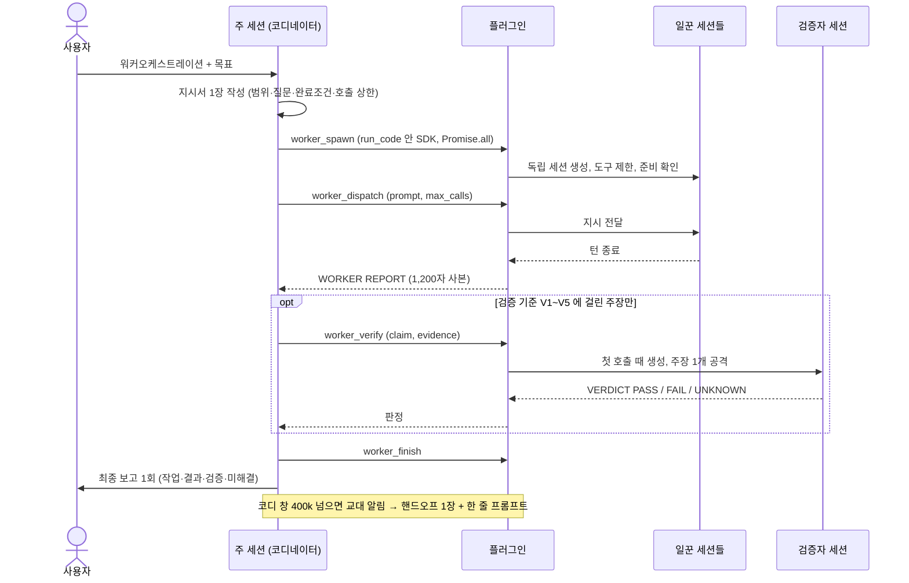

# DSH Worker Orchestration

> **주 세션은 나누기만 하고, 일은 자기 대화를 가진 일꾼들이 합니다.**
> DeepSeek Harness(DSH) 데스크톱 앱용 플러그인 + 스킬. 서브에이전트를 부를 때마다 토큰이 새는 문제를 막으려고 만든 **토큰을 아끼는 오케스트레이터**입니다.

[](LICENSE)


English: [README-en.md](README-en.md)

---

## 한눈에 보기

```text
사용자 ──▶ 주 세션 (코디네이터)          ← 나누고·모으고·합치기만 한다
              │  worker_spawn / worker_dispatch   (run_code 안 SDK 호출)
              ▼
     ┌────────┼────────┬────────┐
   일꾼 A   일꾼 B   일꾼 C   검증자        ← 각자 자기 대화 = 자기 창·자기 캐시
     │        │        │        │
     └── [WORKER REPORT] 1,200자 사본만 주 세션으로 ──┘   전문은 파일·worker_result
```

| 이 레포에 든 것 | 위치 | 역할 |
|---|---|---|
| **플러그인** `dsh-worker-orchestrator` | [`plugins/dsh-worker-orchestrator/`](plugins/dsh-worker-orchestrator) | `worker_*` 도구 10개 등록, 일꾼 세션 생성·지시·보고 배달, 상한·거절 규칙을 **코드로 강제** |
| **스킬** `worker-orchestration` | [`worker-orchestration/`](worker-orchestration) | 코디네이터가 "언제 몇 명을 어떻게 나눌지" 판단하는 짧은 규칙(101줄) + 교대용 핸드오프 양식 |

---

## 강점 — 토큰을 아끼는 오케스트레이터

일꾼을 나눠 쓰는 플러그인은 많습니다. 이 프로젝트는 **나눠 쓰는 데 드는 토큰을 줄이는 것**에 집중했고, 그 효과를 실측으로 확인했습니다.

| 강점 | 하는 일 | 실측 (작성자 환경) |
|---|---|---|
| **절약 규칙을 코드가 지킨다** | 프롬프트에 부탁만 하지 않고 플러그인이 막습니다. 일꾼별 호출 상한 쪽지, 동시 실행 4·슬롯 8, 실행 중 일꾼 재지시 거절 | 일꾼 71%가 호출 6회 초과 → 상한 쪽지 **4/4 준수** |
| **주 세션은 가볍게** | 보고는 1,200자 사본만 들어오고 전문은 필요할 때만 꺼내 봅니다. 창이 400k를 넘으면 핸드오프 1장으로 교대 | 주 세션 토큰 = 일꾼 합의 **1.88배 → 0.59배** |
| **검증은 필요할 때만** | 되돌리기 어려운 결정·충돌·근거 공백 같은 기준(V1~V5)에 걸린 주장만 검증. 검증자는 8회 상한, 시간 초과 시 정지 | 검증자 **212만 토큰·판정 0** → 다음 실전 검증 0회 |
| **일꾼 시작 토큰 다이어트** | 일꾼에게 스킬 목록·관리 도구를 보여 주지 않고, 모든 지시를 같은 접두부로 시작해 캐시를 계속 맞춤 | 일꾼마다 매 스텝 붙던 스킬 목록 12,414자 제거, 일꾼 캐시 적중 94.8% |
| **가볍게 설치** | 의존성 0, 플러그인 파일 1개 + 스킬 폴더 1개, 가짜 앱 테스트 5개 | — |

---

## 왜 만들었나 — 서브에이전트 호출의 토큰 과다 소모

DSH에서 큰 일을 하위 에이전트로 나누면 **하위 작업의 결과가 부르는 쪽 세션의 창(context window)으로 돌아와 쌓입니다.**
부르는 세션은 그 뒤 매 스텝마다 커진 창을 통째로 다시 보내므로(캐시 읽기도 토큰입니다), 일을 많이 나눌수록 부모 세션 한 곳의 비용이 눈덩이처럼 불어납니다.
긴 보고와 중간 출력이 전부 부모 창에 남는 것이 핵심 원인이었습니다.

그래서 방향을 바꿨습니다.

- **일꾼 = 서브에이전트가 아니라 자기 대화를 가진 세션.** 터미널 멀티플렉서 Herdr에서 탭마다 에이전트 칸을 따로 띄우듯, 일꾼마다 자기 창·자기 캐시를 가진 DSH 대화를 새로 만듭니다. 일꾼이 읽은 양은 일꾼 창에만 쌓입니다.
- **주 세션은 나누기만, 창에는 보고 사본만.** 주 세션(코디네이터)은 직접 분석하지 않고 나누기·모으기·합치기만 합니다. 보고는 보고당 1,200자 사본만 들어오고, 전문은 필요할 때만 `worker_result` 나 산출물 파일로 봅니다.
- **창이 커지면 교대.** 코디네이터 창이 400k 토큰을 넘으면 플러그인이 교대 알림을 넣고, 핸드오프 파일 한 장 + 한 줄 프롬프트로 새 코디네이터에게 넘깁니다.

---

## 컨텍스트 엔지니어링 — DSH 데스크톱 앱에 맞춘 설계

Herdr 스킬이 짧은 안내만 두고 실제 설명서는 실행 파일(`hc --skill`)에서 받아 오듯, 이 프로젝트도 **스킬 글은 짧게, 규칙은 실행 코드에** 둡니다.
스킬은 "무엇을 언제" 판단하는 기준만 담고, "어떻게"는 도구 설명과 거절 메시지가 맡습니다. 규칙을 어기면 도구가 거절하면서 이유와 고칠 방법을 돌려주므로, 모델이 긴 규칙 문서를 매번 다시 읽을 필요가 없습니다.

| 원칙 | 구현 |
|---|---|
| **창 분리** | 일꾼은 DSH Agent service로 만든, 자기 대화를 가진 일반 세션(서브에이전트 아님). 주 세션 창에는 1,200자 보고 사본만 들어갑니다. |
| **규칙은 코드가 강제** | 일꾼별 `run_code` 호출 상한 쪽지(`max_calls`, 기본 6, 2배에서 한 번 더) · 같은 코디네이터의 동시 실행 4 · 전역 슬롯 8 · 분당 spawn 10 · 모델 다양성 게이트 · 실행 중 일꾼에 dispatch 거절 · 검증자에 dispatch/resume 거절 |
| **일꾼 시작 덩어리 최소화** | 일꾼 세션에서는 `worker_*`·`gui_*`·`skill` 도구를 숨깁니다. 스킬 목록(작성자 환경 12,414자)이 일꾼마다 붙어 매 스텝 다시 읽히던 것을 없앴고, 일꾼이 또 일꾼을 부르는 것도 막힙니다. |
| **캐시 친화 접두부** | 모든 일꾼 프롬프트 맨 앞에 글자까지 같은 STABLE 문단을 두고, 날짜·ID 같은 가변값은 그 뒤에만 둡니다. 공급자의 접두부 캐시가 계속 맞습니다. |
| **PTC(code mode)** | `worker_*` 는 `run_code` 안에서 SDK로 부릅니다. 같은 단계의 독립 호출(spawn 여럿, 읽기·grep)은 한 번의 `run_code` 에 `Promise.all` 로 묶습니다. |
| **보고는 밀어 주기, 폴링 없음** | 일꾼 턴이 끝나면 플러그인이 `[WORKER REPORT]` 를 코디네이터에 넣습니다(1.5초 묶음, 4초 간격, 자동 알림 6회 예산). 코디네이터가 상태를 계속 물어볼 필요가 없습니다. |
| **교대(rotation)** | 코디네이터 창 400k부터 50k마다 `[교대 알림]`. 받은 코디네이터는 일꾼을 회수·종료하고 핸드오프 1장을 쓴 뒤 한 줄 프롬프트를 남깁니다. 다음 코디네이터는 그 파일 1개만 읽고 시작합니다. |
| **검증은 기준에 걸릴 때만** | 검증 1회 = 일꾼 1명 몫 비용. 되돌리기 어려운 결정·보고 충돌·근거 공백·사용자 요청·테스트 불가 코드 변경(V1~V5)일 때만 `worker_verify`. 검증자는 첫 호출 때 만들고, effort high·`run_code` 8회·100초 뒤 판정 재촉·60초 뒤 정지·같은 주장 1회입니다. |

---

## 어떻게 구동되나



1. **분류** — 코디네이터가 요청을 ANALYSIS / REVERSE / BUILD / RESEARCH / ADVERSARIAL / MIXED 로 나누고 일꾼 수를 정합니다(대상이 25,000자 미만이면 1명, 그 밖에는 8,000자당 1명, 최대 6).
2. **지시서** — 일꾼마다 파일·줄 범위, 질문 1개, 셀 수 있는 완료조건, 금지 범위, 산출물 경로, 모델·effort, 호출 상한을 표 한 장에 적습니다. 지시서가 없으면 보내지 않습니다.
3. **생성·지시** — `worker_spawn` 이 독립 세션을 만들고 짧은 준비 확인을 합니다(10분 캐시). `worker_dispatch` 가 지시를 보내고 `max_calls` 를 겁니다.
4. **실행** — 일꾼은 자기 범위만 읽고, 상한 안에서 끝내고, FINDINGS / EVIDENCE / CONFIDENCE / OPEN 4필드로 1,000자 안에 보고합니다. 상한에 닿으면 플러그인이 `[호출 상한]` 쪽지를 넣습니다.
5. **수거** — 턴이 끝나면 보고가 코디네이터로 배달됩니다. 코디네이터는 필요한 것만 `worker_result` 로 전문을 보고 `worker_finish` 로 슬롯을 돌려줍니다.
6. **검증(필요할 때만)** — 핵심 주장 1개를 `worker_verify` 로 넘기면 검증자가 반박을 시도하고 첫 줄에 `VERDICT` 를 씁니다.
7. **보고·교대** — 사용자에게는 마지막에 한 번만 보고합니다. 창이 커지면 핸드오프로 다음 코디네이터에게 넘깁니다.

---

## 기존 문제와 해결 (작성자 환경 실측)

실전 배분을 전수 점검하면서 찾은 문제와, 그 뒤 플러그인·스킬에서 고친 내용입니다. 숫자는 작성자 PC의 세션 기록에서 잰 값입니다.

| 문제 | 실측 | 해결 |
|---|---|---|
| 일꾼 도구 호출 폭주 | 일꾼 187명 중 71%가 `run_code` 6회 초과, 최대 93회 (2026-11-17 점검, 호출 상한 지시 누락 12/14) | `max_calls` 상한 쪽지를 플러그인이 직접 넣음 → 다음 실전에서 쪽지 4/4 모두 먹힘(쪽지 뒤 같은 턴 추가 호출 0) |
| 코디네이터 창 비대 | 코디네이터 토큰 합 = 산하 일꾼 합의 **1.88배**, 373~384스텝·창 43~49만 토큰까지 끌고 감 | 400k 교대 알림 + 핸드오프 릴레이 → 다음 실전 **0.59배** |
| 동시 실행 겹침 | 한 코디네이터가 일꾼 최대 12명을 동시에 돌림 | 동시 4·슬롯 8을 플러그인이 강제(넘으면 거절) |
| 검증자 무판정 소모 | 검증자 2명이 **212만 토큰**을 쓰고 판정 0건(verify 4회: 시간 초과 3, 판정 줄 없음 1). 생산 일꾼 4명 합의 77% | effort max→high, `run_code` 8회 상한, 100초 뒤 판정 재촉→60초 뒤 정지, 같은 주장 재검증 금지, **기준(V1~V5)에 걸릴 때만** 검증 |
| 일꾼마다 붙는 스킬 목록 | 일꾼·검증자 첫 호출 입력 21.6~22.1k 토큰 중 스킬 목록 12,414자, 매 스텝 다시 읽힘 | 일꾼에서 `skill` 도구를 숨겨 목록 자체가 안 만들어지게 함 |
| 보고마다 코디네이터가 깨고 보고가 긺 | 알림 7회 → 코디네이터 새 턴 5회(매번 창 9~11만 재읽기), 보고 8건 중 7건이 1,000자 초과 | 채팅 사본 보고당 1,200자, 전문은 `worker_result`·파일 |
| 교대 알림이 갇힘 | 코디네이터 자기 턴 끝에서 바로 알림을 넣으면 앱 루프가 아직 running이라 깨우지 않음 | 코디네이터가 idle이 될 때까지(최대 30초) 기다렸다가 알림 |
| 검증자가 2명이 됨 | 취소한 검증자를 `worker_resume` 해 같은 코디네이터에 검증자 2명 | 검증자 resume·dispatch는 거절, 검증자는 `worker_verify` 만 만든다 |
| 보고 재전달 | `worker_reports(clear)` 뒤 예약된 알림이 같은 보고를 또 보냄 | 수거된 보고는 예약 알림에서 뺌 |

> 검증자 관련 고침(v4-r2)은 테스트로만 확인했고, 고친 뒤 실전 측정은 아직입니다. 측정되면 이 표를 갱신합니다.

---

## 요구 사항

- **DeepSeek Harness 데스크톱 앱**(플러그인 프로필 사용). 작성자는 Windows의 `desktop` 프로필에서 씁니다. 플러그인은 앱 안의 Node(22 이상)에서 돌고 외부 의존성은 없습니다.
- 일꾼으로 쓸 모델 경로. 모델 다양성 게이트는 같은 패밀리 생산 일꾼이 이미 있으면 다른 패밀리(deepseek ↔ glm)를 권합니다. 같은 모델로만 돌리려면 `allow_model_repeat: true` 를 넘깁니다.
- 검증자 경로. 기본값은 공급자 `vercel-pareto` + `deepseek/deepseek-v4.1-flash-1017` 입니다. 내 DSH에 없는 경로라면 아래 환경 변수로 바꿉니다.
- 선택: `gui_*` 도구(일꾼 창 배치)는 별도 플러그인 `dsh-worker-gui` 몫이며 이 레포에 없습니다. 없어도 동작합니다.

---

## 설치

### 1. 받기

```bash
git clone https://github.com/AION-Battlecruiser/dsh-skills.git
```

### 2. 스킬 넣기

DSH는 `~/.agents/skills`, `~/.dsh/skills`, 프로젝트 `.agents/skills` 를 감시하므로 복사하면 재시작 없이 목록에 나타납니다.

```bash
cp -r dsh-skills/worker-orchestration ~/.agents/skills/
```

```powershell
Copy-Item -Recurse dsh-skills\worker-orchestration $HOME\.agents\skills\
```

### 3. 플러그인 넣기

플러그인 폴더를 프로필의 `plugins/` 아래로 복사합니다(`<DSH_HOME>` 은 보통 `~/.dsh`).

```bash
cp -r dsh-skills/plugins/dsh-worker-orchestrator ~/.dsh/profiles/desktop/plugins/
```

프로필의 `package.json` 에 의존성과 번들을 한 줄씩 추가합니다.

```jsonc
// ~/.dsh/profiles/desktop/package.json
{
  "dependencies": {
    "dsh-worker-orchestrator": "file:plugins/dsh-worker-orchestrator"
  },
  "dsh": {
    "profile": {
      "bundles": ["…기존 항목…", "dsh-worker-orchestrator"]
    }
  }
}
```

프로필 폴더에서 의존성을 다시 깔고 앱을 재시작합니다.

```bash
cd ~/.dsh/profiles/desktop && pnpm install
```

### 4. (선택) 환경 변수

| 변수 | 기본값 | 뜻 |
|---|---|---|
| `DSH_ORCH_DIR` | `~/.dsh/worker-orchestrator` | 상태 폴더: `plugin.log`, `worker_reports.log`, `workers.json`, `handoff/` |
| `DSH_ORCH_VERIFIER_PROVIDER` | `vercel-pareto` | 검증자 공급자 id |
| `DSH_ORCH_VERIFIER_MODEL` | `deepseek/deepseek-v4.1-flash-1017` | 검증자 모델 id |
| `DSH_ORCH_CTL` | (꺼짐) | `1` 이면 디버그용 파일 제어 통로를 켭니다. 아래 [보안](#보안) 참고 |

앱 프로세스가 읽는 환경이어야 하므로, 바꾼 뒤에는 앱을 완전히 껐다 켭니다(Windows: `setx DSH_ORCH_DIR D:\work\_orch` 후 재시작).

### 5. 확인

`<DSH_ORCH_DIR>/plugin.log` 에 아래 줄이 찍히면 정상입니다.

```text
… module loaded v4-r3 dir=C:/Users/you/.dsh/worker-orchestrator ctl=disabled
… registered=worker_spawn,worker_dispatch,worker_verify,worker_finish,worker_reports,worker_transfer,worker_status,worker_result,worker_cancel,worker_resume
… ctl=off
```

---

## 사용법

### 시작하기

DSH 세션에서 평소처럼 일을 시키되, 앞에 `워커오케스트레이션:` 을 붙이거나 "워커로 나눠", "병렬로 돌려", "교차검증", "반박해봐" 같은 말을 쓰면 스킬이 걸립니다.

```text
워커오케스트레이션: src/payment 아래에서 중복 결제가 나는 원인을 찾아줘. 고치지는 말고 원인과 근거만.
```

그러면 코디네이터는

1. 일을 분류하고(위 예시는 ANALYSIS, 대상 크기에 따라 1~2명),
2. `_orch/dispatch/<작업명>.md` 에 지시서를 쓰고,
3. 일꾼을 띄워 지시하고,
4. 보고가 오면 합쳐서,
5. 마지막에 **작업 / 결과 / 검증 / 미해결** 4필드로 한 번만 보고합니다.

검증 기준에 걸리지 않아 검증하지 않은 결론에는 `미검증(기준 해당 없음)` 이 붙습니다.

### 요청 예시

| 말하기 | 유형 | 기본 일꾼 수 |
|---|---|---|
| "분석해", "원인 찾아" | ANALYSIS | 1 |
| "역공학해", "번들 뜯어" | REVERSE | 1~2 |
| "구현해", "고쳐" | BUILD | 1 |
| "자료 찾아", "근거 수집" | RESEARCH | 3 |
| "적대적 검증", "반박해봐" | ADVERSARIAL | 2 |
| 섞인 작업 | MIXED | 4~8 |

단일 파일 수정, 단순 질문, 한 번짜리 명령에는 쓰지 않습니다. 그런 일은 그냥 시키는 쪽이 쌉니다.

### 교대와 이어 하기

- 코디네이터 창이 400k를 넘으면 `[교대 알림]` 이 오고, 코디네이터가 핸드오프를 쓴 뒤 아래 한 줄을 남깁니다.
- 사용자가 직접 `교대` 라고 해도 같은 절차를 밟습니다.
- 새 세션에 그 한 줄을 그대로 붙여 넣으면 이어서 갑니다.

```text
워커오케스트레이션: <handoff_dir>\결제버그_02.md 읽고 '다음 할 일'부터 바로 이어서 작업 시작
```

`handoff_dir` 은 교대 알림과 `worker_status` 출력에 나옵니다(기본 `~/.dsh/worker-orchestrator/handoff`). 양식은 [`worker-orchestration/handoff_template.md`](worker-orchestration/handoff_template.md) 입니다.

### 도구 목록 (코디네이터 전용)

모두 `run_code` 안에서 SDK로 부릅니다. 일꾼 세션에는 보이지 않습니다.

| 도구 | 하는 일 | 주요 인자 |
|---|---|---|
| `worker_spawn` | 독립 일꾼 세션 생성 + 준비 확인 | `model`, `provider`, `effort`, `cwd`, `auto_finish`, `allow_model_repeat`, `ttl_minutes`, `verify` |
| `worker_dispatch` | 일꾼에 지시를 보내고 턴 시작 | `worker_id`, `prompt`, `max_calls`(기본 6), `wait` |
| `worker_verify` | 주장 1개를 검증자에게 넘겨 `VERDICT` 받기 | `claim`, `evidence`, `target`, `focus` |
| `worker_reports` | 밀린 보고 받기 | `clear`, `limit` |
| `worker_result` | 일꾼의 최신 출력 전문 | `worker_id`, `wait` |
| `worker_status` | 일꾼 상태 + `handoff_dir` | `worker_id`, `include_released` |
| `worker_finish` | 결과 넘기고 창 닫고 슬롯 반환 | `worker_id` |
| `worker_cancel` | 턴 중단 + 종료 | `worker_id` |
| `worker_resume` | 저장된 일꾼 세션 다시 붙이기(검증자 제외) | `worker_id` |
| `worker_transfer` | 내 일꾼을 다른 코디네이터 세션에 넘기기 | `to_session_id`, `worker_ids` |

### 검증 기준 (축5)

기본은 **검증 안 함**입니다. 아래 중 하나에 걸리는 핵심 주장만 `worker_verify` 로 넘깁니다.

| | 기준 |
|---|---|
| V1 | 되돌리기 어려운 결정의 근거(삭제·배포·결제·외부 전송·원본 수정) |
| V2 | 보고끼리 충돌하거나, 보고가 이미 확정된 사실과 어긋남 |
| V3 | 핵심 주장인데 근거가 비었거나 확신이 낮음 |
| V4 | 사용자가 검증·교차검증·반박을 요청 |
| V5 | 코드 변경인데 테스트·실행으로 확인할 수단이 없음 |

파일 목록, grep, 수치 추출, 이미 명령·테스트 출력으로 확인된 것, 독립 일꾼 2명이 서로 다른 근거로 같은 결론을 낸 것에는 붙이지 않습니다.

---

## 설정값 (코드 상수)

자주 바꿀 일이 없어 환경 변수로 빼지 않은 값입니다. 바꾸려면 `plugins/dsh-worker-orchestrator/index.mjs` 를 고칩니다.

| 상수 | 값 | 뜻 |
|---|---|---|
| `ROTATION_NOTIFY_AT` / `ROTATION_STEP` | 400,000 / 50,000 | 교대 알림 시작 창 크기와 간격 |
| `MAX_WORKERS` | 8 | 전역 슬롯(검증자·다른 코디네이터 일꾼 포함) |
| 동시 실행 | 4 | 같은 코디네이터의 running 일꾼 수 |
| `MAX_SPAWN_PER_MINUTE` | 10 | 분당 생성 |
| `DEFAULT_TTL_MINUTES` / `VERIFIER_TTL_MINUTES` | 120 / 30 | 놀고 있는 일꾼·검증자 회수 시간 |
| `CHAT_REPORT_MAX` | 1,200 | 코디네이터 채팅에 넣는 보고 사본 길이 |
| `VERIFIER_EFFORT` / `VERIFY_MAX_CALLS` | high / 8 | 검증자 추론 강도·호출 상한 |
| `WAIT_TIMEOUT_MS` / `VERIFY_STOP_GRACE_MS` | 100,000 / 60,000 | 기다림 상한, 시간 초과 뒤 검증자 정지까지 |

---

## 보안

- **제어 통로(ctl)는 기본으로 꺼져 있습니다.** `DSH_ORCH_CTL=1` 이면 플러그인이 `<DSH_ORCH_DIR>/ctl/in/*.json` 의 `code` 를 **앱 안에서 그대로 실행**합니다. 그 폴더에 쓸 수 있는 프로세스는 누구든 앱 권한으로 코드를 돌릴 수 있다는 뜻입니다. 혼자 쓰는 PC에서 디버깅할 때만 켜십시오.
- 일꾼은 코디네이터 작업 폴더 밖에 쓰지 않도록 스킬이 막습니다. 밖에 쓰려 하면 승인 요청이 뜨는데 일꾼 세션에는 대답할 사람이 없어 멈추기 때문입니다.
- 플러그인은 네트워크로 아무것도 보내지 않습니다. 모델 호출은 DSH가 설정한 공급자로만 갑니다.

---

## 테스트

가짜 앱으로 돌리는 Node 테스트 5개입니다. 파일 함수를 가로채므로 실제 상태 폴더는 건드리지 않습니다.

```bash
cd plugins/dsh-worker-orchestrator
npm test        # = node test/caps.test.mjs && … && node test/env.test.mjs
```

| 파일 | 다루는 것 |
|---|---|
| `test/caps.test.mjs` | 호출 상한 쪽지, 동시 실행·슬롯 상한 |
| `test/rotation.test.mjs` | 교대 알림 시점·전달·재시도 |
| `test/fix.test.mjs` | 동시 spawn 경합, 전역 슬롯, 제어 통로 소유권 |
| `test/fix2.test.mjs` | 회귀 52개(검증자 정책, 보고 배달, 재전달 방지 등) |
| `test/env.test.mjs` | 환경 변수 없을 때 기본 폴더·제어 통로 꺼짐 |

---

## 알려진 한계

- DSH 플러그인 내부 API(Agent service, 세션 이벤트, `tools.restrict` 등)에 기대므로 앱 업데이트에 깨질 수 있습니다.
- 테스트는 가짜 앱 기준입니다. 실제 앱에서는 `plugin.log` 로 확인합니다.
- 호출 상한은 **쪽지**입니다. 일꾼을 강제로 끊지 않습니다. 검증자만 시간 초과 뒤 정지합니다.
- 검증 판정은 검증자의 마지막 텍스트 메시지에서만 읽습니다.
- 앱이 모든 세션에 넣는 전역 지침(AGENTS.md 등)은 일꾼에도 붙습니다. 플러그인으로 빼는 공식 방법은 아직 없습니다.
- 일꾼은 `skill` 도구가 숨겨져 있어 스킬을 직접 읽지 못합니다. 필요한 규칙은 코디네이터가 지시에 넣어야 합니다.
- 스킬 본문은 한국어입니다.

---

## 레포 구조

```text
dsh-skills/
├─ plugins/dsh-worker-orchestrator/
│  ├─ index.mjs            # 플러그인 본체 (의존성 0)
│  ├─ cordis.patch.yml     # 번들 자동 장착
│  ├─ package.json
│  └─ test/                # 가짜 앱 테스트 5개
├─ worker-orchestration/
│  ├─ SKILL.md             # 코디네이터 규칙 v10
│  └─ handoff_template.md  # 교대 핸드오프 양식
├─ sync.ps1                # (작성자용) ~/.agents/skills → 레포 동기화
├─ LICENSE
├─ README.md
└─ README-en.md
```

---

## 기여 — PR 환영합니다

버그 제보, 다른 환경(macOS·Linux·다른 공급자)에서 돌려 본 결과, 토큰 실측 비교, 영어 스킬 번역 모두 환영합니다.

- 이슈: 무엇을 했고, 무엇을 기대했고, 실제로 무엇이 일어났는지 + `plugin.log` 관련 줄
- PR:
  - `npm test` 가 모두 통과해야 합니다.
  - 버그를 고칠 때는 그 버그를 재현하는 테스트를 먼저 넣어 주세요(고치기 전에는 실패, 고친 뒤 통과).
  - 규칙은 가능하면 스킬 문장이 아니라 플러그인 코드(거절·쪽지)로 넣어 주세요. 스킬은 짧게 유지합니다.
  - 토큰을 줄였다고 할 때는 전후 실측(세션 기록 기준)을 함께 붙여 주세요.

---

## 라이선스

[MIT](LICENSE) © 2026 AION-Battlecruiser
